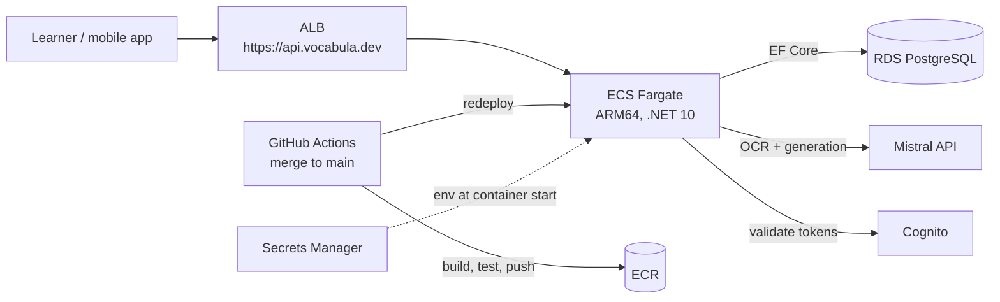

# Vocabula

**Storytelling application generating personalized reading content for language learners.**
Learners photograph their study material, the API extracts the vocabulary and grammar they've acquired with the help of an LLM, and the next chapter of their own story is generated against that knowledge.

[](https://github.com/Pepert/Vocabula/actions/workflows/deploy-api.yml)
[](https://api.vocabula.dev/swagger)

**Live:** the API runs on AWS at **[api.vocabula.dev/swagger](https://api.vocabula.dev/swagger)** — deployed end-to-end by GitHub Actions (merge to `main` → build → test → push to ECR → health-gated ECS rollout).

## What's in this repo

| Layer | Tech |
|---|---|
| API | ASP.NET Core (.NET 10), EF Core, PostgreSQL |
| AI | Mistral API — OCR extraction (`mistral-ocr-latest`) + story generation |
| Auth | Amazon Cognito (JWT validation, users auto-provisioned in PostgreSQL) |
| Infrastructure | Terraform — ECS Fargate (ARM64/Graviton), RDS, ALB, Route 53, ACM, Secrets Manager, Cognito |
| CI/CD | GitHub Actions with OIDC (no stored cloud credentials), ARM64 runners |

The frontend (React Native / Expo) lives in a sibling repo: `VocabulaFrontend`.

## Architecture



Full infrastructure documentation: [docs/architecture/aws-deployment.md](docs/architecture/aws-deployment.md) — including the local deployment walkthrough, cost breakdown, and the reasoning behind each choice.

### API endpoints

- `POST /api/knowledge/extract` — extract structured vocabulary and grammar from a notebook image (multipart upload)
- `POST /api/stories/generate` — generate the next part of the learner's story from acquired knowledge
- `GET /api/users/me` — identity of the authenticated user (Cognito JWT required)
- `GET /health` — health check (public)

## Running locally

```bash
# PostgreSQL via Docker Compose
docker compose up -d postgres

# Configure secrets (never committed — see .env.example entries in README history)
# MISTRAL_API_KEY, AUTHENTICATION__COGNITO__*, ConnectionStrings__VocabulaDb

dotnet run --project src/Vocabula.Api
# Swagger at http://localhost:5001/swagger
```

The solution structure:

- `src/Vocabula.Core` — domain models and AI services (no ASP.NET dependencies)
- `src/Vocabula.Infrastructure` — EF Core persistence, migrations, PostgreSQL
- `src/Vocabula.Api` — ASP.NET Core Web API
- `terraform/` — the full AWS stack, applied manually (infra changes never run in CI)
- `docs/` — architecture and deployment documentation

## Deploy to AWS

The infrastructure is defined in [`terraform/`](terraform/) and documented in
[docs/architecture/aws-deployment.md](docs/architecture/aws-deployment.md).

CI deploys the application: **merging to `main` builds, tests, and rolls out a new version automatically** (GitHub Actions assumes a least-privilege IAM role via OIDC — no long-lived cloud credentials in the repo).

Infrastructure changes (Terraform) are applied manually from the developer machine:

```bash
cd terraform
terraform apply -var-file=prod.tfvars
```
