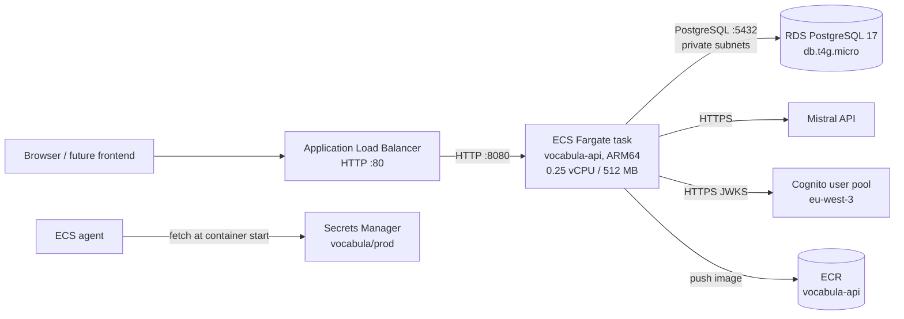

# AWS deployment (ECS Fargate)

How the Vocabula API runs on AWS, and the exact commands to deploy it from a
local machine. The infrastructure is defined with Terraform in [`terraform/`](../../terraform/)
and follows the architecture chosen for the MVP.

## Architecture



Key decisions:

- **ECS Fargate (ARM64/Graviton)** over Lambda: the knowledge extraction calls
  the Mistral OCR API with a 2-minute timeout, EF Core holds a normal database
  connection pool, and the app is a plain Kestrel container. Always-on at MVP
  scale.
- **Dedicated VPC**: the Fargate task runs in public subnets with a public IP
  (no NAT gateway, which alone costs ~$32/month). RDS runs in private subnets
  and is reachable only from the ECS task.
- **Secrets Manager**: one JSON secret (`vocabula/prod`) holds
  `MISTRAL_API_KEY` and the PostgreSQL connection string. The ECS agent
  injects them as environment variables at container start, so the
  application code never talks to AWS and needs no changes.
- **Cognito managed by Terraform**: the user pool, app client and hosted UI
  domain are created by Terraform and wired directly into the ECS task
  definition (authority + app client id), so the values never need to be
  copied into `prod.tfvars`. Users are created manually via the AWS CLI so
  that passwords stay out of Terraform state.
- **HTTP only** for now; a 443 listener with an ACM certificate is added once
  the frontend needs HTTPS (it needs a domain name first).

Approximate monthly cost: **~$45** (ALB $16, Fargate 0.25 vCPU/512 MB $14,
RDS db.t4g.micro $13, Secrets Manager $0.40/secret, data transfer).

## Prerequisites

- Terraform >= 1.6 (`brew install hashicorp/tap/terraform`)
- AWS CLI configured with credentials that can create resources
- Docker (with buildx for ARM64 images; native on Apple Silicon)

## One-time setup

### 1. Fill in the variables

```bash
cp terraform/prod.tfvars.example terraform/prod.tfvars
# edit terraform/prod.tfvars: set mistral_api_key and db_password
```

`prod.tfvars` is gitignored: it holds the Mistral API key and the database
password. Note that Terraform state also contains these values; the state
bucket is private to your account.

### 2. Bootstrap the Terraform state backend (once, ever)

```bash
cd terraform/bootstrap
terraform init
terraform apply
cd ../..
```

This creates the S3 bucket that stores the state. State locking uses the
S3-native lockfile (Terraform >= 1.11), so no DynamoDB table is involved.
The main configuration references the bucket name in its backend block,
so nothing else is needed afterwards.

### 3. Deploy the infrastructure

```bash
cd terraform
terraform init
terraform plan -var-file=prod.tfvars
terraform apply -var-file=prod.tfvars
```

The first apply creates the VPC, ECR repository, Secrets Manager secret, RDS
instance, ECS cluster, task definition and load balancer. The ECS service will
not start tasks yet because the ECR repository is still empty.

### 4. Build and push the container image

```bash
ECR_URL=$(cd terraform && terraform output -raw ecr_repository_url)

aws ecr get-login-password --region eu-west-3 \
  | docker login --username AWS --password-stdin $(dirname $ECR_URL | cut -d/ -f1)

docker buildx build \
  --platform linux/arm64 \
  -t "${ECR_URL}:latest" \
  --push .
```

The Dockerfile runs the test suite as part of the build, so the first build
takes a few minutes. Once the image is pushed, the ECS service starts a task;
after the health check (`GET /health`) passes twice, the API is live.

### 5. Verify

```bash
API=$(cd terraform && terraform output -raw api_url)
curl $API/health
# {"status":"healthy"}
```

`api_url` (`https://api.vocabula.dev`) routes to the load balancer via
Route 53 with a TLS certificate; plain HTTP requests to the load balancer or
the API domain are redirected to HTTPS. The Swagger UI is at
`https://api.vocabula.dev/swagger` (for a valid Cognito token, see
`AuthenticationTests` / the Cognito user pool in `eu-west-3`).

DNS delegation: `vocabula.dev` is registered at Porkbun; the Route 53 zone's
nameservers (`terraform output domain_nameservers`) must be set as the
domain's nameservers at the registrar.

## Database access from your machine

RDS lives in private subnets, so it is unreachable from outside the VPC by
default. To work on the database from your machine (DBeaver, psql, EF Core
migrations), set your public IP as a CIDR in `terraform/prod.tfvars`:

```hcl
allow_db_access_from = "203.0.113.5/32"
```

then apply. This opens PostgreSQL (5432) to that single IP and gives the
instance a routable public address. Find your current IP with
`curl https://checkip.amazonaws.com`. The IP lives only in the gitignored
`prod.tfvars`. Set it back to `""` whenever you want the database closed
again.

## Database migrations

With `allow_db_access_from` set to your IP (see above):

```bash
cd terraform
terraform apply -var-file=prod.tfvars
cd ..

# Run the EF Core migration against the remote database
export ConnectionStrings__VocabulaDb=$(aws secretsmanager get-secret-value \
  --secret-id vocabula/prod --region eu-west-3 \
  --query SecretString --output text | python3 -c \
  "import json,sys; print(json.load(sys.stdin)['ConnectionStrings__VocabulaDb'])")
export MISTRAL_API_KEY=dummy
export AUTHENTICATION__COGNITO__AUTHORITY=$(cd terraform && terraform output -raw cognito_authority)
export AUTHENTICATION__COGNITO__APPCLIENTID=$(cd terraform && terraform output -raw cognito_app_client_id)

dotnet ef database update \
  --project src/Vocabula.Infrastructure \
  --startup-project src/Vocabula.Api
```

The dummy values for the Mistral/Cognito variables are only there because
`Program.cs` validates their presence at design time; they are not used to
talk to AWS.

## Cognito users

The user pool, app client and hosted UI domain are created by Terraform.
Users themselves are created manually so that passwords never enter
Terraform state:

```bash
POOL_ID=$(cd terraform && terraform output -raw cognito_user_pool_id)
CLIENT_ID=$(cd terraform && terraform output -raw cognito_app_client_id)

aws cognito-idp admin-create-user \
  --user-pool-id $POOL_ID \
  --username user@example.com \
  --region eu-west-3

# Set a permanent password for local token minting
aws cognito-idp admin-set-user-password \
  --user-pool-id $POOL_ID \
  --username user@example.com \
  --password 'A-Strong-Password!' \
  --permanent \
  --region eu-west-3

# Mint a test access token
TOKEN=$(aws cognito-idp admin-initiate-auth \
  --user-pool-id $POOL_ID \
  --client-id $CLIENT_ID \
  --auth-flow ADMIN_USER_PASSWORD_AUTH \
  --auth-parameters USERNAME=user@example.com,PASSWORD='A-Strong-Password!' \
  --region eu-west-3 \
  --query 'AuthenticationResult.AccessToken' \
  --output text)

curl -H "Authorization: Bearer $TOKEN" http://$ALB/api/users/me
```

The API validates tokens against the pool that Terraform wired into the
task definition, so no configuration values are copied anywhere.

## Day-to-day operations

- **Deploy a new version**: push a new image (`docker buildx build ... --push`),
  then force a new deployment if you re-used the same tag:
  `aws ecs update-service --cluster vocabula --service vocabula-api --force-new-deployment --region eu-west-3`
- **Rotate a secret**: update `terraform/prod.tfvars`, then
  `terraform apply -var-file=prod.tfvars` and force a new deployment.
- **Logs**: CloudWatch log group `/ecs/vocabula-api`.
- **Destroy everything**:
  `cd terraform && terraform destroy -var-file=prod.tfvars`.
  ⚠️ `aws_db_instance` is configured with `skip_final_snapshot = true`, so
  destroying deletes the database and its data without a final snapshot.
  Change that before the database holds anything you care about.

## Open questions

- Should the Fargate service scale to zero overnight (no users yet) to cut
  the ~$14/month compute cost?
