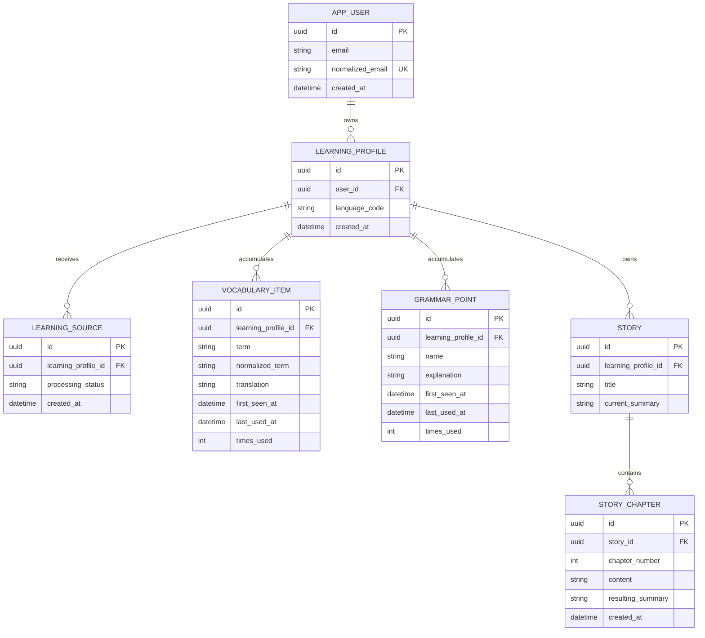
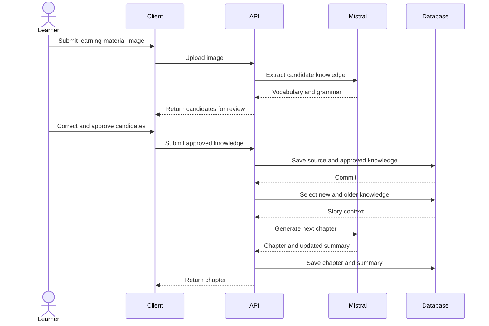

# Draft data model

> Status: exploration. This is a discussion aid, not an approved database schema.

## Goals

The data model needs to support:

- a Swedish-only MVP while retaining a low-cost path to additional languages;
- photographs or other learning sources submitted over time;
- AI-extracted knowledge that can be reviewed before approval;
- accumulated vocabulary and grammar per learner and language;
- one or more evolving stories composed of chapters;
- selection of both newly acquired and older knowledge for story generation;
- enough history to understand which knowledge appeared in which chapter.

## Conceptual entity-relationship diagram

Relationships between learning sources and extracted knowledge, and between story chapters and the knowledge they use, are intentionally not modelled yet. They remain open design questions rather than assumed join tables.

## Current modelling decisions

### User identity

- `APP_USER.id` is a stable UUID primary key and is used by foreign keys.
- Email is a unique sign-in attribute, not the primary key, because it may change.
- `normalized_email` provides case-normalized uniqueness.
- An external authentication subject is not part of the current conceptual schema. It can be added after an authentication provider is selected without replacing Vocabula's internal UUID.

### Language scope

- Accounts choose one learning language at a time (English, French, Spanish or Swedish) via `APP_USER.learning_language`; it drives the active learning profile behind knowledge extraction, story generation and the chapter list.
- There is no `LANGUAGE` lookup table: a language catalogue in code (`Vocabula.Core.Languages.LearningLanguages`) validates codes and feeds the AI prompts.
- `LEARNING_PROFILE.language_code` stores the studied language; every profile of a user is kept, so switching languages switches to that language's knowledge and chapters without losing anything.
- The daily chapter quota is per user across all their learning profiles.
- Vocabulary translations, new-word definitions and word glosses are produced in the account's UI language (`APP_USER.language`), English by default; definitions are stored in the language they were written in.

### Vocabulary ownership

- `VOCABULARY_ITEM` represents knowledge acquired by one learner, not a global Swedish dictionary.
- The same term may therefore exist for multiple learning profiles.
- A future canonical `LEXEME` table is deliberately deferred because reliable normalization of inflections, meanings, and multi-word expressions is a separate product problem.
- Story generation loads a bounded selection of vocabulary and grammar; it never loads every learner's complete knowledge set.

## Proposed invariants

These are proposals to discuss, not final decisions:

- A learning profile is unique by `(user_id, language_code)`.
- Learning profiles are created lazily, the first time material is added under that language.
- Switching the account's learning language never creates or destroys profiles; it only changes which one is active.
- A normalized vocabulary term is unique within a learning profile, subject to validating how multiple meanings and parts of speech should be represented.
- A learning source belongs to exactly one learning profile.
- Extracted knowledge is not considered approved merely because the model returned it.
- A chapter number is unique within a story.
- Story generation should include all newly approved knowledge plus a bounded selection of older knowledge.
- A failed story-generation request must not discard already approved knowledge.
- Initial vocabulary queries should be supported by indexes beginning with `learning_profile_id`, including access by `normalized_term`, `first_seen_at`, and `last_used_at`.

## Candidate write flow

The Mistral call should not occur inside a long-running database transaction. Approved knowledge can be committed first; chapter generation and chapter persistence can then form a separate operation.

## Open questions

1. Does each learning profile own exactly one evolving story, or can a learner start several stories in the same language?
2. Should a story summary live only on `STORY`, only per chapter, or in both places for history and fast access?
3. Can one source introduce the same item more than once, and should occurrence counts be recorded?
4. Is an extraction stored before review, or can the unapproved result remain temporary?
5. Should edited and rejected AI suggestions be retained for evaluation?
6. Does vocabulary uniqueness need to include part of speech or meaning in addition to the normalized term?
7. How should proficiency, confidence, and last-practiced information be represented?
8. Should chapter-to-knowledge usage be recorded explicitly, or inferred from generated text?
9. What is retained from an uploaded image: the image, a storage reference, a hash, metadata, or nothing after extraction?
10. If story generation fails, should the user retry immediately or should a durable background job handle it?
11. Which authentication provider will supply `external_auth_subject`, and is email uniqueness enforced by Vocabula or that provider?
12. What deletion behavior is required when a user, learning profile, source, or story is removed?

## Physical-schema follow-up

After the conceptual model is agreed:

1. Decide entity ownership and lifecycle.
2. Define required fields, indexes, uniqueness constraints, and foreign-key deletion rules.
3. Add explicit join entities where relationship metadata is needed.
4. Implement the model with EF Core and PostgreSQL migrations.
5. Add integration tests against PostgreSQL.
6. Update this document whenever the implemented model intentionally changes.
